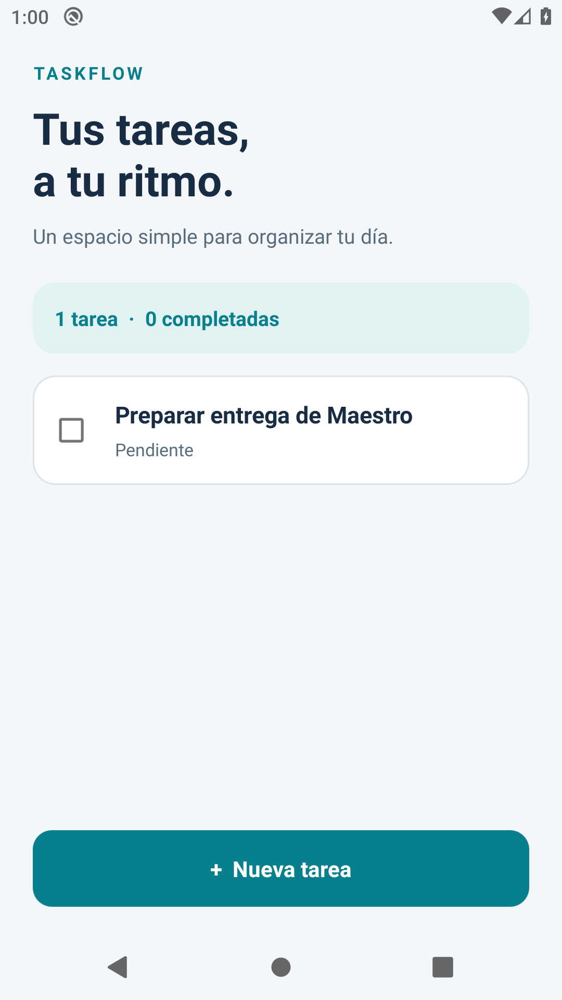
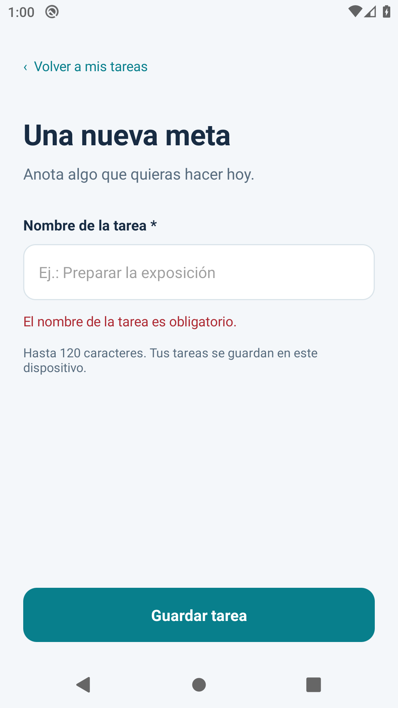
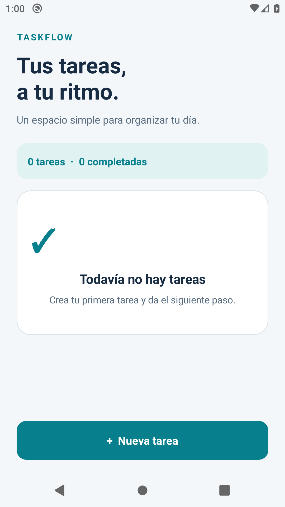
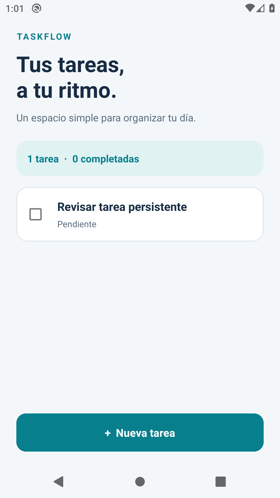

# Automatización de recorridos móviles con Maestro

## Portada

**Proyecto:** TaskFlow, gestión local de tareas personales  
**Actividad:** Automatización de recorridos móviles con Maestro  
**Asignatura:** Mobile Testing con Maestro  
**Autoría:** cuenta del repositorio jefroMMM  
**Fecha:** 29 de octubre de 2026  
**Zona horaria de los registros:** America/Guatemala  
**Repositorio:** https://github.com/jefroMMM/Mobile-Testing-con-Maestro

La institución, el nombre académico del estudiante y el docente no fueron proporcionados. Este informe identifica la autoría mediante la cuenta del repositorio, sin atribuir datos personales o institucionales no verificados.

## 1. Introducción y objetivo

Las pruebas de recorridos móviles permiten comprobar una experiencia de uso completa, desde una acción del usuario hasta su resultado visible. Esta actividad aplica Maestro a una aplicación Android pequeña para examinar tres aspectos: la creación correcta de datos, la validación de una entrada obligatoria y la conservación de la información al cerrar y reabrir la aplicación.

El objetivo es entregar una implementación reproducible, con código fuente, flujos independientes, comprobaciones explícitas y evidencias auténticas. Se distingue la revisión del código y de la sintaxis de la ejecución sobre un dispositivo. Ningún escenario se considera aprobado sin haber completado realmente sus acciones y assertions.

## 2. Descripción de la aplicación

TaskFlow es un gestor de tareas personales para Android. Su pantalla principal muestra la lista de tareas y un contador de tareas totales y completadas. El usuario puede abrir un formulario, introducir un nombre y guardar. Si intenta guardar un nombre vacío o compuesto únicamente por espacios, la aplicación muestra un mensaje de validación y mantiene el formulario abierto.

Cada tarea puede marcarse como completada mediante una casilla. La interfaz diferencia su estado con texto y estilo visual. La navegación permite regresar a la lista mediante un botón o la acción Atrás de Android. Los nombres admiten hasta 120 caracteres; se eliminan los espacios iniciales y finales.

La implementación utiliza Java 17 y vistas nativas Android. Las tareas y su estado se serializan en JSON dentro de `SharedPreferences`. El guardado síncrono finaliza antes de volver a la lista, para que una detención inmediata del proceso no dependa de una escritura pendiente. No se necesita autenticación, servidor remoto ni conexión durante el uso.

## 3. Entorno de ejecución

| Componente | Estado o configuración |
| --- | --- |
| Sistema detectado | Windows 11 Pro 10.0.26200, x64 |
| Procesador detectado | Intel Core i5-7440HQ |
| Virtualización de firmware | Desactivada según la consulta del sistema |
| Java, SDK, ADB y Maestro al iniciar | No se encontraron en el entorno inicial |
| JDK verificado localmente | Eclipse Temurin 17.0.20.1+1 |
| JDK utilizado en CI | Eclipse Temurin 17.0.21+9 |
| PowerShell verificado localmente | 7.6.5, ejecutable pwsh |
| ADB verificado localmente | 37.0.1 |
| SDK instalado localmente | Plataforma API 35, revisión 2; Build Tools 34.0.0 |
| Gradle / plugin Android | 8.9 / 8.7.3 |
| SDK mínimo / compilación / destino | API 26 / API 35 / API 35 |
| Identificador de la aplicación | dev.maestro.taskflow |
| Versión de la aplicación | 1.0.0, código 1 |
| Maestro instalado en CI | CLI 2.12.0 |
| Dispositivo físico autorizado | Xiaomi 24090RA29G, Android 16 / API 36 |
| Emulador de CI configurado | Android 10 / API 29, x86_64, perfil pixel_2 |
| Dispositivo de pruebas completadas | Emulador Android 10 / API 29, x86_64, perfil pixel_2, ADB emulator-5554 |

Se verificaron Java y ADB y se instalaron los paquetes locales del SDK. Se conectó y autorizó un teléfono Xiaomi mediante depuración USB; su identificador se omite de los registros públicos. No fue necesario instalar un emulador local al disponer del teléfono. Las pruebas Maestro acreditadas en este informe corresponden al emulador de CI; la conexión del teléfono no se presenta como una ejecución de esos recorridos.

Se ejecutó un workflow de GitHub Actions sobre Ubuntu 22.04, con Java 17 y un emulador Android 10/API 29 `default`, x86_64, perfil `pixel_2`, acelerado con KVM. Esta vía completó una validación real sin depender de la virtualización del equipo Windows. La ejecución 40982924351 aprobó compilación, lint, instalación de Maestro y APK, los tres escenarios individuales, la suite y el caso adicional. El JDK del runner fue Temurin 17.0.21+9, distinto de la versión local, porque `setup-java` resuelve Java 17 en el entorno de CI.

El registro comenzó el 29 de octubre de 2026 a las 18:59:53, hora de Guatemala, equivalente a `2026-10-30T00:59:53Z`. El código probado corresponde al commit `70268e2ca5a730477c965ef0430aacb8f87a7749`; una etiqueta final posterior puede incorporar documentación y evidencias sin modificar ese código.

## 4. Diseño de los escenarios

Los tres flujos se encuentran en archivos YAML separados. Cada uno restablece los datos antes de comenzar, por lo que no necesita resultados de otra prueba. Se utilizan IDs de recursos Android completos, combinados con textos esperados cuando corresponde. No se utilizan coordenadas. Las esperas se basan en la aparición de elementos y en las capacidades de sincronización de Maestro; no hay pausas fijas agregadas.

| Escenario | Objetivo | Precondiciones | Acciones principales | Resultado esperado | Resultado observado |
| --- | --- | --- | --- | --- | --- |
| 01. Creación | Crear una tarea válida | APK instalado, Android disponible y datos vacíos | Abrir formulario, escribir y guardar | Título visible y contador igual a una tarea | Aprobado: título y contador visibles; estado vacío ausente |
| 02. Validación | Impedir nombre vacío | APK instalado, Android disponible y datos vacíos | Guardar formulario vacío y volver a lista | Error visible, cero tareas y ningún título | Aprobado: error visible; lista vacía y cero tareas |
| 03. Persistencia | Recuperar una tarea tras cerrar y reabrir | APK instalado y Android disponible; datos vacíos al inicio | Crear, verificar, detener y reabrir sin limpiar | La misma tarea permanece visible | Aprobado: misma tarea disponible tras reapertura |

### 4.1. Escenario 01: recorrido funcional exitoso

Archivo: `.maestro/01-crear-tarea.yaml`.

El flujo comienza con `launchApp` y `clearState: true`, espera el estado vacío y abre el formulario con `new_task_button`. Introduce «Preparar entrega de Maestro» en `task_name_input`, oculta el teclado y pulsa `save_task_button`. Comprueba el título y el contador de una tarea; además, exige que desaparezca el estado vacío. La captura generada se identifica como `01-creacion/resultado`.

**Resultado observado:** aprobado. El título «Preparar entrega de Maestro» apareció en la lista, el contador indicó una tarea y no apareció el estado vacío. El caso individual completó sus assertions en 18.535 s, con `SUCCESS` y cero fallos en JUnit.

### 4.2. Escenario 02: validación de entrada

Archivo: `.maestro/02-validar-nombre.yaml`.

Después de preparar la lista vacía, el flujo abre el formulario y pulsa Guardar sin introducir texto. Comprueba el mensaje «El nombre de la tarea es obligatorio.» mediante el ID `validation_error`. Conserva una captura del error, vuelve a la lista y comprueba tres condiciones: estado vacío visible, contador de cero tareas y ausencia de `task_title`. Las capturas generadas son `02-validacion/error` y `02-validacion/lista-vacia`.

**Resultado observado:** aprobado. Se mostró el mensaje obligatorio y, al regresar, la lista permaneció vacía con cero tareas y ningún título. El caso individual completó sus assertions en 11.731 s. La comprobación de la lista complementa el mensaje de error y verifica que no se guardó una tarea inválida.

### 4.3. Escenario 03: condición móvil de cierre y reapertura

Archivo: `.maestro/03-persistencia.yaml`.

El flujo limpia datos únicamente al inicio, crea «Revisar tarea persistente» y verifica que el título existe. Captura el estado anterior, ejecuta `stopApp` y abre de nuevo con `clearState: false`. Después comprueba el mismo título, el contador de una tarea y la ausencia del estado vacío. Las capturas generadas se identifican como `03-persistencia/antes` y `03-persistencia/despues`.

La detención del proceso y su nueva apertura ejercitan la recuperación desde almacenamiento local. No se borra información entre ambos momentos. Esta condición representa un ciclo de vida móvil concreto; su alcance no comprende reinicio del sistema operativo, falta de energía ni corrupción del almacenamiento.

**Resultado observado:** aprobado. «Revisar tarea persistente» siguió visible después de detener el proceso y reabrir sin borrar datos; el contador indicó una tarea y el estado vacío estuvo ausente. El caso individual completó sus assertions en 21.616 s.

### 4.4. Cobertura adicional

El archivo `.maestro/extras/04-completar-tarea.yaml` crea una tarea, marca su casilla, comprueba el estado Completada y el contador, y verifica el estado después de reabrir. Se ejecutó por separado y no sustituye ninguno de los tres escenarios exigidos. Aprobó en 20.597 s.

## 5. Assertions y estabilidad

`assertVisible` comprueba que el elemento esperado sea visible. `assertNotVisible` comprueba su ausencia. Los flujos exigen contenido, cantidad y cambios de estado, de modo que terminar las pulsaciones por sí solo no constituye una prueba aprobada.

Los controles se localizan con IDs como `dev.maestro.taskflow:id/task_name_input` y `dev.maestro.taskflow:id/save_task_button`. Los títulos usan `task_title` y el texto concreto de la tarea. Las filas comparten IDs según su función; en estos escenarios se crea una única tarea y su contenido se comprueba explícitamente.

El límite de 30 segundos de `extendedWaitUntil` constituye una espera máxima condicionada al estado esperado. No obliga a detener la prueba durante todo ese intervalo si el elemento aparece antes.

## 6. Capturas y evidencias

Las siguientes capturas proceden de la ejecución real de Maestro en CI, iniciada el 29 de octubre de 2026 a las 18:59:53, hora de Guatemala. Son copias de consulta sin edición de imagen; los originales se conservan en los artefactos de cada caso. Los logs y los informes JUnit respaldan las comprobaciones, mientras las imágenes documentan los estados visibles.

| Evidencia requerida | Identificador que genera el flujo | Estado |
| --- | --- | --- |
| Tarea creada | 01-creacion/resultado | Captura real; escenario aprobado |
| Error obligatorio | 02-validacion/error | Captura real; escenario aprobado |
| Lista sin tarea inválida | 02-validacion/lista-vacia | Captura real; escenario aprobado |
| Tarea antes del cierre | 03-persistencia/antes | Captura real; escenario aprobado |
| Tarea después de reabrir | 03-persistencia/despues | Captura real; escenario aprobado |

### Figura 1. Escenario 01: tarea creada



### Figura 2. Escenario 02: validación obligatoria



### Figura 3. Escenario 02: lista vacía después del rechazo



### Figura 4. Escenario 03: antes de cerrar


### Figura 5. Escenario 03: después de reabrir



El script de pruebas organiza las ejecuciones en `evidencias/runs/`, con fecha y hora de Guatemala. Conserva el log, el listado de dispositivos, un resumen JSON, el informe JUnit si Maestro lo genera y los artefactos de diagnóstico. Los nombres de captura se encuentran dentro del directorio de artefactos de cada ejecución; Maestro puede añadir subcarpetas.

En GitHub Actions, `scripts/ci-tests.sh` conserva los registros en `evidencias/ci/`. Registra fecha UTC y de Guatemala, versiones, propiedades del emulador, commit ejecutado, instalación y una tabla `results.tsv`. Cada ejecución individual y la suite tienen directorios propios. El workflow publica estos archivos, el APK y el resultado de lint en el artefacto `taskflow-delivery`, con retención de 30 días.

## 7. Resultados de ejecución

| Verificación | Resultado acreditado |
| --- | --- |
| Implementación del código Android | Archivos fuente y recursos creados |
| Análisis YAML | Archivos analizados con PyYAML 6.0.3 |
| Compilación y lint CI | assembleDebug y lintDebug aprobados en ejecución 40982924351; APK generado |
| Compilación y lint local | BUILD SUCCESSFUL, 2 min 12 s |
| Instalación del APK en emulador | Success, registrado en install.log |
| Maestro individual: escenario 01 | Aprobado; 18.535 s; cero fallos |
| Maestro individual: escenario 02 | Aprobado; 11.731 s; cero fallos |
| Maestro individual: escenario 03 | Aprobado; 21.616 s; cero fallos |
| Maestro: suite completa | 3/3 aprobados; cero fallos; 44.196 s según JUnit |
| Prueba adicional de completado | Aprobada; 20.597 s |

Los tres casos obligatorios aprobaron individualmente y volvieron a aprobar como suite. `evidencias/ci/results.tsv` registra código de salida cero para 01, 02, 03, suite y extra. Los JUnit verifican `SUCCESS` y cero fallos. En la suite, la suma de tiempos de los casos es 44.174 s y el tiempo global registrado por JUnit es 44.196 s. La evidencia demuestra estos recorridos en este entorno; no implica cobertura de todos los dispositivos o situaciones posibles.

El APK de CI descargado para la entrega tiene SHA-256 `7250036ff691654b835440560303a54132a11f56d0ef553df9798ff4ed95f330`. Su procedencia y suma se registran en `evidencias/ci/build/apk-sha256.txt`.

En la primera ejecución de CI, lint detectó que el atributo `windowLightNavigationBar` exige API 27, aunque el mínimo declarado es API 26. Se corrigió trasladando el atributo a recursos `values-v27`; la ejecución 40982924351 confirmó compilación y lint satisfactorios. La detección es un resultado de análisis estático y no una assertion fallida de los escenarios Maestro.

## 8. Preparación y limpieza de datos

Cada escenario comienza eliminando los datos de la aplicación mediante `clearState: true`, inicia la app y exige la lista vacía. Esto elimina dependencias de orden y permite repetir cada caso individualmente. La limpieza afecta las tareas locales de esta aplicación.

Los datos finales se conservan después del recorrido para que puedan revisarse. La siguiente prueba vuelve a limpiar al inicio. Para restablecer manualmente se utiliza `scripts/clean-data.ps1`, que ejecuta `adb shell pm clear dev.maestro.taskflow`. Este comando no debe ejecutarse durante la pausa entre el guardado y la reapertura del escenario de persistencia.

La aplicación no requiere permisos de ejecución ni sesiones de usuario. El entorno de pruebas necesita ADB autorizado y un Android disponible. Con varios dispositivos se debe indicar el serial mediante `-Device`.

## 9. Dependencias reales y simuladas

Las dependencias de compilación son Java, Gradle, Android Gradle Plugin y Android SDK. La ejecución móvil requiere ADB, un Android físico o emulado y Maestro. Las descargas iniciales necesitan conexión a Internet; los recorridos de la aplicación no consultan servicios remotos.

No hay autenticación simulada, backend simulado ni respuestas de red prefabricadas. Las vistas y el almacenamiento corresponden a la implementación real. El dispositivo virtual utilizado fue el emulador Android de CI, acreditado mediante sus propiedades, logs y resultados en `evidencias/ci/`.

## 10. Reproducción

Desde la raíz del repositorio, en PowerShell 7 o posterior, con ejecutable `pwsh` disponible. Los scripts se verifican con PowerShell 7.6.5; no se promete compatibilidad con Windows PowerShell 5.1. Las variables de herramientas se configuran por sesión, sin modificar globalmente PATH:

```powershell
pwsh -ExecutionPolicy Bypass -File .\scripts\bootstrap.ps1
pwsh -ExecutionPolicy Bypass -File .\scripts\build.ps1
pwsh -ExecutionPolicy Bypass -File .\scripts\create-emulator.ps1
pwsh -ExecutionPolicy Bypass -File .\scripts\start-emulator.ps1
. .\scripts\env.ps1
adb devices -l
adb shell getprop sys.boot_completed
```

Con el dispositivo listo y `sys.boot_completed` igual a `1`:

```powershell
pwsh -ExecutionPolicy Bypass -File .\scripts\install.ps1
pwsh -ExecutionPolicy Bypass -File .\scripts\test.ps1 -Scenario 01
pwsh -ExecutionPolicy Bypass -File .\scripts\test.ps1 -Scenario 02
pwsh -ExecutionPolicy Bypass -File .\scripts\test.ps1 -Scenario 03
pwsh -ExecutionPolicy Bypass -File .\scripts\test.ps1 -Scenario all
```

Si se emplea un teléfono, se omiten la creación y el inicio del emulador. Si hay varios dispositivos se añade `-Device SERIAL` a instalación, pruebas y limpieza. El modo `start-emulator.ps1 -Software` permite intentar el inicio sin aceleración, sujeto a las limitaciones del equipo.

También puede reproducirse mediante GitHub: abrir **Actions → Android y Maestro → Run workflow**, seleccionar la rama y ejecutar. El workflow compila, verifica lint, instala el APK y ejecuta los tres flujos individuales, la suite y el caso adicional. Al finalizar se descarga `taskflow-delivery` y se revisan `evidencias/ci/results.tsv`, los JUnit y las capturas. La vinculación entre pruebas y código se consulta en `tested-commit.txt`.

## 11. Limitaciones

La compilación, lint y los recorridos móviles aprobaron en el emulador Android 10 de CI. Se intentó instalar el APK en el teléfono Xiaomi Android 16, pero Android devolvió `INSTALL_FAILED_USER_RESTRICTED: Install canceled by user`. La instalación fue bloqueada por la política del teléfono y no se ejecutaron allí los recorridos. Se continuó con la alternativa de emulador, ya aprobada, sin necesitar el teléfono para la entrega. La virtualización de firmware está desactivada en el equipo Windows, por lo que no se utilizó un emulador local. El PDF se generó y revisó visualmente: 15 páginas con cinco figuras y tabla comparativa legible. La release se publicó y sus descargas de APK y PDF se comprobaron con HTTP 200 y hash coincidente.

El alcance funcional no incluye edición, eliminación individual ni sincronización entre dispositivos. Los datos se eliminan al limpiar el almacenamiento de la aplicación o desinstalarla. Las pruebas cubren recorridos concretos; no constituyen un análisis exhaustivo de accesibilidad, rendimiento, seguridad ni compatibilidad con todos los modelos Android.

No se dispone de acceso acreditado a Canvas. El informe final se entrega en PDF y como contenido editable; el estudiante debe entrar a la actividad y adjuntar el PDF, el repositorio y el enlace del APK. Puede personalizar los datos académicos de la portada si lo desea. Los datos de institución y docente no se inventan.

## 12. Conclusiones

Se implementó y compiló una aplicación Android acotada, se instaló en un emulador y se ejecutaron tres recorridos independientes con comprobaciones visibles. La creación, el rechazo de entrada vacía y la recuperación desde persistencia local aprobaron individualmente y como suite. También aprobó la prueba adicional del estado completado.

La ejecución real transformó los recorridos en evidencia verificable mediante logs, JUnit y capturas. El uso de CI permitió superar la falta de virtualización del equipo local. La corrección detectada por lint muestra además la utilidad de separar análisis estático y pruebas de interfaz. Los resultados respaldan los escenarios definidos y conservan límites explícitos de dispositivo y cobertura.

## 13. Enlaces y versión de entrega

- Repositorio: https://github.com/jefroMMM/Mobile-Testing-con-Maestro
- Release publicada y verificada: https://github.com/jefroMMM/Mobile-Testing-con-Maestro/releases/tag/entrega-v1.0.0
- Commit probado: https://github.com/jefroMMM/Mobile-Testing-con-Maestro/commit/70268e2ca5a730477c965ef0430aacb8f87a7749
- APK instalable, original de CI: https://github.com/jefroMMM/Mobile-Testing-con-Maestro/releases/download/entrega-v1.0.0/taskflow-debug.apk
- Ejecución de CI: https://github.com/jefroMMM/Mobile-Testing-con-Maestro/actions/runs/40982924351
- PDF final: `output/pdf/informe-academico.pdf`, generado y revisado visualmente.
- Descarga pública del PDF: https://github.com/jefroMMM/Mobile-Testing-con-Maestro/releases/download/entrega-v1.0.0/informe-academico.pdf
- README reproducible: `README.md`.
- Evidencias: `evidencias/`.

El APK y el PDF están publicados como adjuntos de la release `entrega-v1.0.0`. Ambas descargas públicas respondieron HTTP 200 y coincidieron con los archivos locales. La evidencia de publicación se conserva en `evidencias/publicacion-verificada.json`. El APK publicado tiene 17 201 bytes y conserva el SHA-256 de la compilación probada en CI.

## Referencias

Maestro. *Maestro Flows*. https://docs.maestro.dev/maestro-flows  
Maestro. *Maestro CLI*. https://docs.maestro.dev/maestro-cli  
Maestro. *launchApp*. https://docs.maestro.dev/reference/commands-available/launchapp.md  
Maestro. *stopApp*. https://docs.maestro.dev/reference/commands-available/stopapp.md  
Maestro. *takeScreenshot*. https://docs.maestro.dev/reference/commands-available/takescreenshot.md

